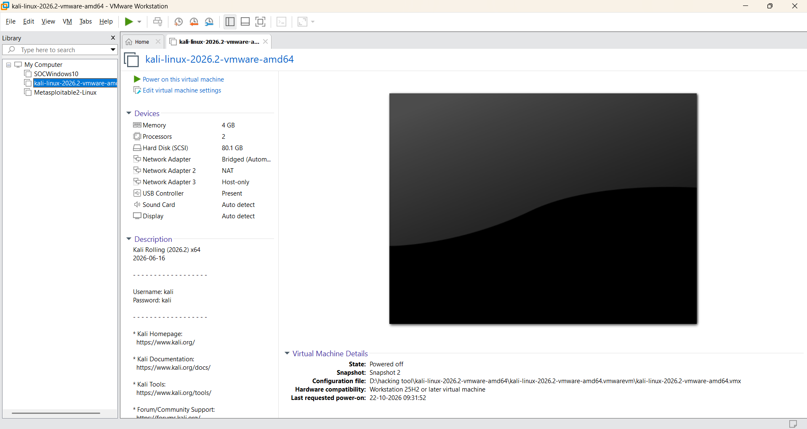
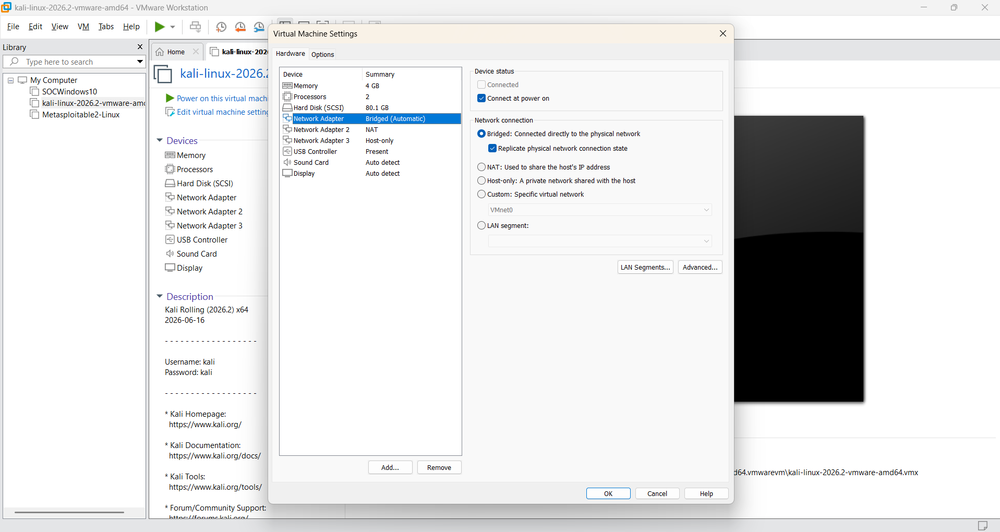
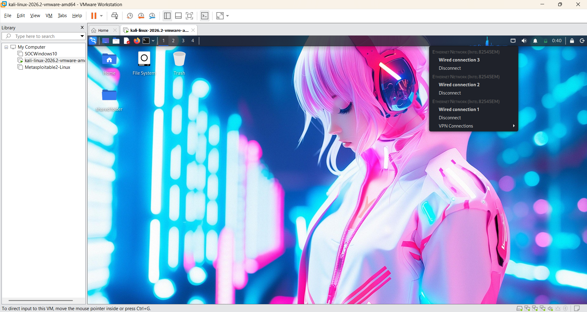
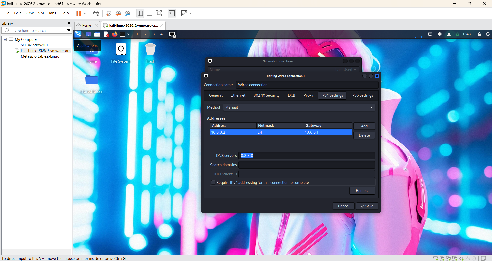

# 🔐 Cybersecurity Lab Setup: VMware + Kali Linux

**My personal virtual lab for ethical hacking, penetration testing and SOC practice.**


---

## 📌 Project Overview

I built this lab so I have a safe place to practise security tools without touching my main system or anyone else's network.

Everything runs inside **VMware Workstation** on my Windows machine. **Kali Linux** is my attacking machine, and I keep a couple of other VMs next to it (Metasploitable2 and a Windows 10 machine) to scan, test and analyse. If I break something, I roll back to a snapshot and carry on.

This README documents how the lab is set up, so I can rebuild it quickly and so others can follow the same steps.

---

## 🎯 Objectives

- Set up VMware Workstation and import Kali Linux as a virtual machine.
- Give the Kali VM multiple network adapters (Bridged, NAT and Host-only) so I can choose how it connects.
- Set a fixed IP address on Kali so it is easy to reference in notes and exercises.
- Share a folder between my host and the Kali VM to move files in and out.
- Take snapshots so I can always return to a clean state.
- Build a base I can reuse for TryHackMe rooms, vulnerability assessment and SOC practice.

---

## 🛡️ What I Use the Lab For

- Network reconnaissance and port scanning (Nmap)
- Packet capture and analysis (Wireshark)
- Vulnerability assessment
- Practising attacks against intentionally vulnerable machines
- Log analysis and detection practice on the Windows VM
- Trying out new security tools safely

⚠️ **Important:** This lab is for learning. I only test machines I own or have clear permission to test. Never point these tools at systems you do not have authorization for.

---

## 🏗️ Lab Overview

The VMware Library holds three machines:

| VM | Role |
|----|------|
| `kali-linux-2026.2-vmware-amd64` | Attacker / main working machine |
| `Metasploitable2-Linux` | Intentionally vulnerable target |
| `SOCWindows10` | Windows machine for SOC and log-analysis practice |



---

## ⚙️ Lab Configuration

| 🧩 Component | ⚙️ Configuration |
|--------------|------------------|
| 🖥️ Host OS | Windows |
| 🧰 Hypervisor | VMware Workstation (25H2) |
| 🐉 Guest OS | Kali Linux (Rolling) 2026.2, x64, build dated 2026-06-16 |
| 🧠 Memory | 4 GB |
| ⚙️ Processors | 2 |
| 💽 Disk | 80.1 GB (SCSI) |
| 🌐 Network Adapter 1 | Bridged (Automatic) |
| 🌐 Network Adapter 2 | NAT |
| 🌐 Network Adapter 3 | Host-only |
| 🐧 Kali IP (Wired connection 1) | 10.0.0.2/24, set manually |
| 🚪 Gateway | 10.0.0.1 |
| 🌍 DNS | 8.8.8.8 |
| 📁 Shared folder | Enabled, shows up on the Kali desktop |

---

# 🪜 Setup Procedure

## Step 1. Make sure virtualization is on

VMware needs hardware virtualization (Intel VT-x or AMD-V) enabled in BIOS/UEFI. If a VM refuses to start, this is the first thing I check.

---

## Step 2. Install VMware Workstation

I installed VMware Workstation on the Windows host. It is the hypervisor that runs all the lab machines.

---

## Step 3. Download and import Kali Linux

I downloaded the pre-built **Kali Linux VMware image** from the official Kali website: https://www.kali.org/get-kali/

After extracting it, I opened the `.vmx` file in VMware (**File → Open**) and chose **I copied it** when asked.

The VM runs with:

```
Memory:     4 GB
Processors: 2
Disk:       80.1 GB
```

---

## Step 4. Set up the network adapters

The Kali VM has three network adapters, each in a different mode:

| Adapter | Mode | Why it is there |
|---------|------|-----------------|
| Network Adapter | Bridged (Automatic) | Puts Kali directly on my physical network |
| Network Adapter 2 | NAT | Internet access through the host (updates, downloads) |
| Network Adapter 3 | Host-only | Private network shared only with the host and other lab VMs |



Inside Kali, each adapter shows up as its own wired connection (Wired connection 1, 2 and 3):



---

## Step 5. Set a static IP in Kali

On **Wired connection 1** I switched IPv4 from automatic to manual:

```
Method:   Manual
Address:  10.0.0.2
Netmask:  24
Gateway:  10.0.0.1
DNS:      8.8.8.8
```

I did this through the Network Connections editor (right-click the network icon → Edit Connections).



The same thing from the terminal:

```bash
nmcli connection show
sudo nmcli connection modify "Wired connection 1" \
  ipv4.method manual \
  ipv4.addresses 10.0.0.2/24 \
  ipv4.gateway 10.0.0.1 \
  ipv4.dns 8.8.8.8
sudo nmcli connection up "Wired connection 1"
```

A fixed address makes my notes and scan results much easier to follow.

---

## Step 6. Shared folder

I enabled a shared folder in **VM → Settings → Options → Shared Folders**, so I can move files between Windows and Kali. It appears on the Kali desktop as `shared folder`.

If it does not show up, install the VMware guest tools inside Kali:

```bash
sudo apt update
sudo apt install -y open-vm-tools open-vm-tools-desktop
sudo reboot
```

The shared folders are normally mounted under `/mnt/hgfs/`.

---

## Step 7. Snapshots

Once everything worked, I took snapshots from **VM → Snapshot → Take Snapshot**. The VM currently lists **Snapshot 2** as its latest snapshot.

Before doing anything risky, I take a new one. If something breaks, I go to **VM → Snapshot → Revert to Snapshot** and I am back in a working state in a minute.

---

# 🔎 Quick Verification

After setting everything up, I run these checks inside Kali:

| ✅ Test | 🧾 Command | 🎯 What I expect |
|--------|-----------|------------------|
| Check IP address | `ip a` | `10.0.0.2/24` on the configured connection |
| Test gateway | `ping -c 4 10.0.0.1` | Replies come back |
| Test Internet | `ping -c 4 8.8.8.8` | Replies come back |
| Test DNS | `nslookup kali.org` | The domain resolves |
| Check Nmap | `nmap --version` | Version number shows up |
| Check snapshot | Revert, then `ip a` | Settings are back as they were |

---

# 🔒 Keeping the Lab Safe

Network Adapter 1 is **Bridged**, which means the VM sits on the same network as my host and everything else connected to it. That is convenient, but it is not isolated.

Some rules I follow for this lab:

- When working with Metasploitable2 or any other vulnerable VM, disconnect the Bridged adapter and use only NAT or Host-only. In VMware, open **VM → Settings → Network Adapter** and untick **Connected**.
- Never expose a vulnerable machine to the Internet or my home network.
- Change the default Kali password after import.
- Turn off shared folders and clipboard sharing when handling suspicious files.

---

# 🧰 Troubleshooting Notes

A few things worth checking if something goes wrong:

- **VM will not start / VT-x error:** enable Intel VT-x or AMD-V in BIOS/UEFI.
- **VMware complains about Hyper-V or Device Guard:** turn off Hyper-V, Virtual Machine Platform and Windows Hypervisor Platform in *Windows Features*, then reboot.
- **No Internet in Kali after setting a static IP:** check the connection name with `nmcli connection show`, confirm the gateway and DNS, then restart the connection:
  ```bash
  sudo nmcli connection down "Wired connection 1" && sudo nmcli connection up "Wired connection 1"
  ```
- **Several adapters, confusing routes:** run `ip a` and `ip route` to see which adapter holds which address.

---

# 💡 What I Learned

- **Network modes matter.** Bridged, NAT and Host-only behave very differently, and picking the wrong one can expose a lab to the real network.
- **Multiple adapters are powerful but need care.** Each one appears as its own connection in Kali, so I need to know which is which.
- **Static IPs save time.** Notes and scans are cleaner when the attacker machine always has the same address.
- **Snapshots are my safety net.** Take one before trying anything risky.
- **Writing it down helps.** Documenting the setup makes it repeatable and easier to explain.

---

# 🔐 Ethical Use

This lab is for **education and authorized testing only**.

---

# 🔗 Tools & Resources

- **VMware Workstation:** https://www.vmware.com/products/desktop-hypervisor.html
- **Kali Linux:** https://www.kali.org/get-kali/
- **Kali Docs:** https://www.kali.org/docs/
- **Metasploitable2 guide:** https://docs.rapid7.com/metasploit/metasploitable-2/
- **TryHackMe:** https://tryhackme.com

---

# 👤 Author

**Nikhil Kumar**
B.Tech Computer Science | Aspiring SOC Analyst and Ethical Hacker

GitHub: https://github.com/Niikhil184268
